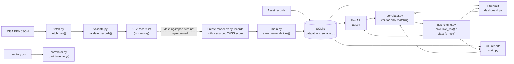
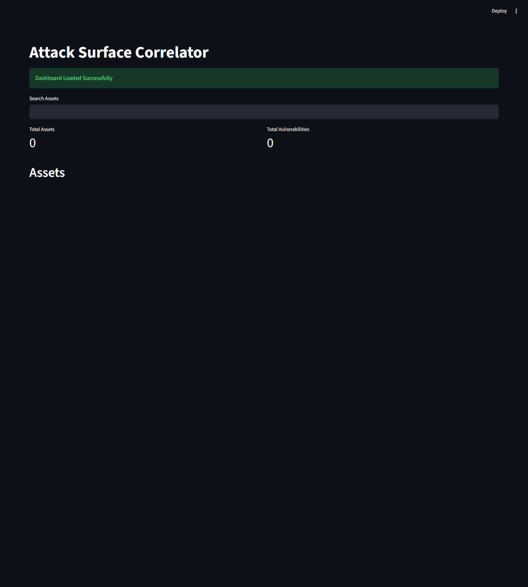

# Attack Surface Correlator

A small Python application for viewing inventoried assets alongside known-exploited-vulnerability data, with vendor-based correlation and risk scoring. It exposes a FastAPI service and a Streamlit dashboard, backed by SQLite and SQLModel.

> **Current scope:** The CISA KEV fetch and validation helpers work independently, but there is not yet an end-to-end importer that maps validated KEV records into database rows. In particular, KEV records do not supply the required `cvss_score`; the project does not invent or automatically populate that value. The current SQLite database may therefore be empty until data is entered through a separate process.

## Architecture



`correlate_asset()` currently matches vendors case-insensitively; it does not require the product to match. `load_inventory()` reads `inventory.csv`, while the dashboard and API currently use `Asset` rows stored in SQLite.

## Dashboard

The screenshot below was captured from the running Streamlit app. It shows the current empty-database state; the asset and vulnerability metrics will update when rows are available.



The dashboard includes asset-name search, asset details, correlated CVE/CVSS entries, and a color-coded risk severity. Search filters the displayed assets while the totals continue to reflect the full database.

## API

Run the API locally and open the interactive documentation at `http://127.0.0.1:8000/docs`.

| Method and path | Behavior |
| --- | --- |
| `GET /` | Service status. |
| `GET /assets` | List all stored assets. |
| `GET /assets/{id}` | Return one asset; a missing ID returns HTTP 404. |
| `GET /vulnerabilities` | List all stored vulnerabilities. |
| `GET /stats` | Return asset and vulnerability totals, plus assets whose criticality is exactly `Critical`. |
| `GET /assets/{asset_id}/risk` | Return a complete per-asset risk assessment based on vendor-matched vulnerabilities. |

Examples:

```powershell
curl.exe http://127.0.0.1:8000/assets
curl.exe http://127.0.0.1:8000/vulnerabilities
curl.exe http://127.0.0.1:8000/stats
curl.exe http://127.0.0.1:8000/assets/1/risk
```

When the database is empty, the collection endpoints return `[]`, and `/stats` returns:

```json
{
  "assets": 0,
  "vulnerabilities": 0,
  "critical_assets": 0
}
```

For an asset with matching vulnerabilities, the risk endpoint includes asset details, the count of vendor matches, the highest CVSS, ransomware exposure, adjusted risk score, and severity. For example:

```json
{
  "asset_id": 1,
  "asset_name": "Cisco Router",
  "ip_address": "10.0.0.1",
  "criticality": "Critical",
  "vulnerability_count": 3,
  "highest_cvss": 9.8,
  "ransomware_exposure": true,
  "risk_score": 19.8,
  "severity": "CRITICAL"
}
```

If the asset exists but has no vendor-matched vulnerabilities, the response is:

```json
{
  "asset_id": 7,
  "asset_name": "Development Server",
  "risk_score": 0,
  "severity": "LOW"
}
```

A nonexistent asset returns HTTP 404:

```json
{
  "detail": "Asset not found"
}
```

## Risk scoring

The score starts at the highest CVSS among the asset's vendor-matched vulnerabilities, then adds:

- **+5** if any matching vulnerability is marked as used in a known ransomware campaign.
- **+5** if the asset's criticality is exactly `Critical` (case-sensitive).

Severity is based on the adjusted score:

| Adjusted score | Severity |
| --- | --- |
| `>= 18` | `CRITICAL` |
| `>= 13` and `< 18` | `HIGH` |
| `>= 8` and `< 13` | `MEDIUM` |
| `< 8` | `LOW` |

## Installation and running (Windows PowerShell)

Run commands from the project root. Python 3.14 was used for this setup.

```powershell
python -m venv venv
.\venv\Scripts\python.exe -m pip install -r requirements.txt
New-Item -ItemType Directory -Force data
.\venv\Scripts\python.exe -c "from database import init_db; init_db()"
```

The database URL is `sqlite:///data/attack_surface.db`. Initialize the schema after creating the `data` directory, and run the commands below from the project root so the relative SQLite path resolves correctly.

Start the API in one terminal:

```powershell
.\venv\Scripts\python.exe -m uvicorn api:app --reload
```

Start the dashboard in another terminal:

```powershell
.\venv\Scripts\python.exe -m streamlit run dashboard.py
```

The API is available at `http://127.0.0.1:8000` and the dashboard at `http://localhost:8501`.

To run the tests:

```powershell
.\venv\Scripts\python.exe -m pytest
```

`main.py` contains duplicate-safe save helpers and a CLI report generator (`python main.py`). There is not yet a complete command that downloads the KEV feed, maps it to database records, sources CVSS scores, and persists the resulting vulnerabilities.

## Future enhancements (proposals)

- Implement an end-to-end KEV ingestion workflow with a documented, reliable CVSS source and explicit handling for missing scores.
- Add asset inventory import and persistence, with validation and duplicate handling.
- Correlate on normalized vendor **and** product where appropriate, rather than vendor alone.
- Add pagination and filtering to API list endpoints, plus authentication before exposing the service beyond localhost.
- Expand the dashboard with trend history, export, and richer remediation context.